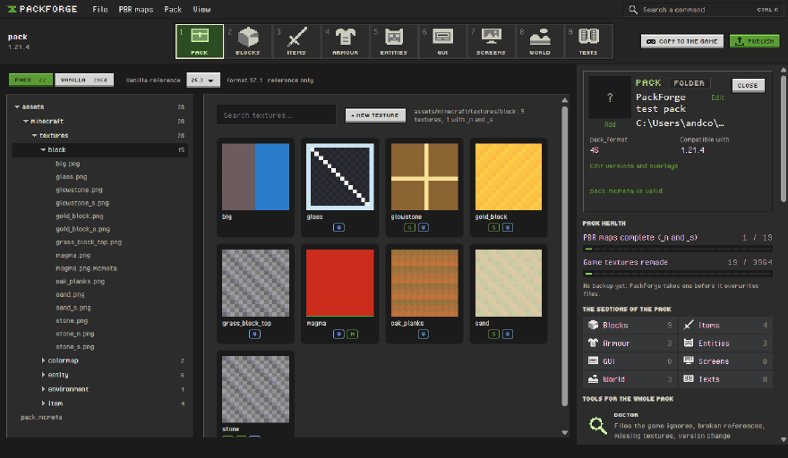
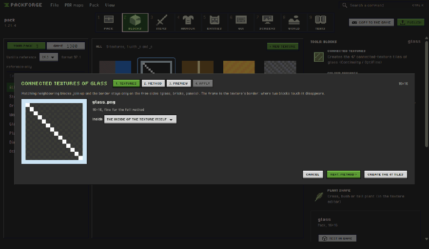
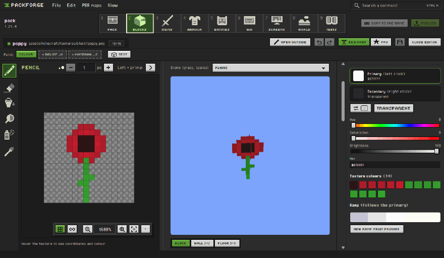
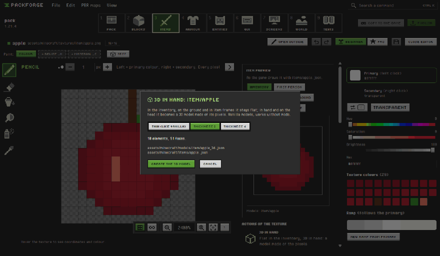
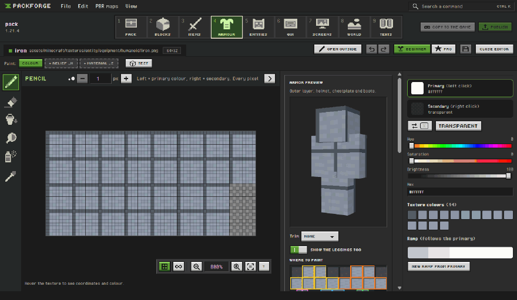
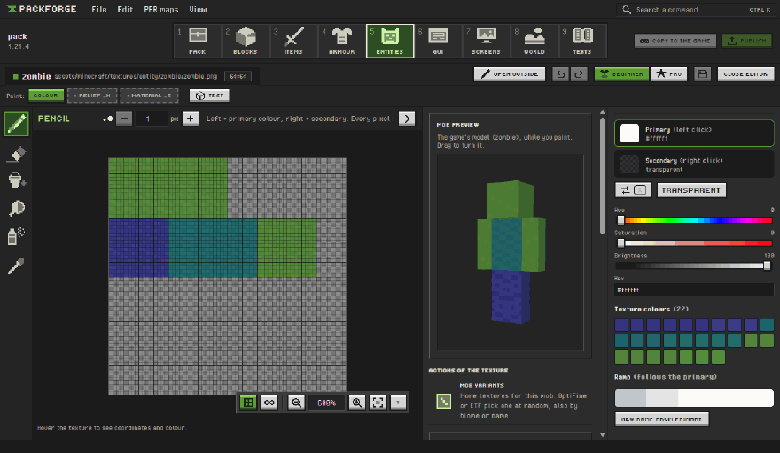
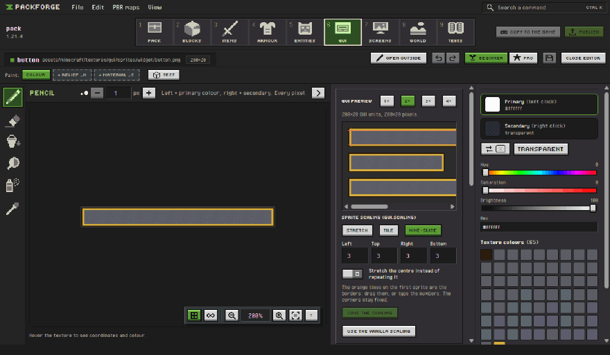

<p align="center">
  
</p>

<h1 align="center">PackForge</h1>

<p align="center">
  A workshop for Minecraft: Java Edition resource packs.<br>
  Paint a texture, give it relief and shine, see it under shader light, drop it in the game.
</p>

<p align="center">
  
  
  
  
  
</p>

> [!CAUTION]
> **This is a prototype, not a finished tool.**
> PackForge is an experiment in what an app that makes resource packs easier _could_ look like.
> It is not in a state where you should use it for a real pack: things are missing, things break,
> and files, menus and formats can change from one commit to the next without warning.
> If you try it anyway, work on a copy of your pack, never on the only one you have.

## Why this exists

Making a resource pack with PBR maps today means four programs open at once: something to draw
in, something to generate normal maps, a text editor for `pack.mcmeta`, and Minecraft itself,
restarted again and again to see if the stone finally looks right under a shader. Half of the
work is moving files around.

PackForge is my attempt to put all of that in one window. You paint a pixel and the 3D block next
to it changes, with the shadows, relief and reflections it will have with a LabPBR shader. When it
looks right, the pack is already in your `resourcepacks` folder and F3 + T does the rest.

<p align="center">
  
</p>

## What works so far

The app is split into nine sections, like the game's hotbar (keys 1–9). Each one lists its
textures, yours next to the vanilla ones from your own game install, and the tools that fit them:

| Section      | What you do there                                                                                                         |
| ------------ | ------------------------------------------------------------------------------------------------------------------------- |
| **Pack**     | Open a folder (or a zip, read-only) or start a new pack. How much you have retextured, the pack doctor, backups, export.  |
| **Blocks**   | The pixel editor with the 3D block next to it, the LabPBR `_n` and `_s` maps, connected textures, crops and plant shapes. |
| **Items**    | Items through their definitions: inventory, in hand, on the head; 3D in hand, variants by anvil name, positions.          |
| **Armour**   | Armour on a 3D player, trims with their patterns and material palettes.                                                   |
| **Entities** | Mob textures, a 3D zombie, husk and drowned, random variants by biome, height or name.                                    |
| **GUI**      | Buttons, inventory and HUD with a nine-slice editor and mock screens; recolour the whole GUI at once.                     |
| **Screens**  | The title screen (panorama, logo, splash texts) and the loading screen.                                                   |
| **World**    | Biome colours (colormaps, Polytone), sky and weather, particles, paintings.                                               |
| **Texts**    | The game's texts for one language: item names and messages.                                                               |

The editor is built around Minecraft textures: pencil, bucket, shade along a colour ramp, noise,
shapes, selections, symmetry, seamless edges, layers and frame animations. Beginner mode hides the
advanced tools and gives tips. **Test** puts the texture in a small world before opening the game
(a wall, a floor, farmland, a house corner, a cave, a path) at noon, sunset, by torchlight, in the
Nether or in the rain. **Publish** exports a zip with version, credits and changelog, and **Copy
to the game** keeps the pack in your `resourcepacks` folder while you work. Interface in
**English or Italian**.

New in 0.3: the nine sections, health bars for the pack, a 3D zombie preview, plant shapes for
flowers, and warnings for the mistakes that break a pack in the game (a panorama missing faces,
trim patterns the game does not recolour, variants never repainted). The full list is in the
[changelog](CHANGELOG.md).

<p align="center">
  
</p>

<p align="center">
  
</p>

<p align="center">
  
</p>

<p align="center">
  
</p>

<p align="center">
  
</p>

<p align="center">
  
</p>

<p align="center">
  
</p>

## Coming next

Roughly in this order, if the prototype survives:

- [x] Game GUI textures: inventory, buttons, the title screen and the loading screen (0.2)
- [x] Armour, armour trims and the new item definitions (0.2)
- [x] Simple block and item models (0.2)
- [ ] A painting engine with pressure brushes and bigger canvases
- [ ] macOS (the Linux build is new and has had very little testing)
- [ ] A signed Windows installer: free signing through SignPath is being set up, see below

## Trying it anyway

You read the warning above. If you still want to poke at it:

**Windows.** Grab `PackForge-Setup-<version>.exe` or the portable zip from
[Releases](https://github.com/Andrix03/packforge/releases). Until the signing is in place,
SmartScreen will say it protected your PC: **More info → Run anyway**.

**Linux.** Take the AppImage, make it executable and run it:

```sh
chmod +x PackForge-<version>.AppImage
./PackForge-<version>.AppImage
```

On Debian or Ubuntu the `.deb` works too: `sudo apt install ./packforge_<version>_amd64.deb`.

Then open a copy of a pack, or make a new one from the start screen.

You need Windows 10 or 11 or a 64-bit Linux, and a graphics card with WebGL 2. For the vanilla reference
textures, Minecraft Java installed with the official launcher. To see the PBR maps in game, a
LabPBR shader pack (for example with Fabric and Iris).

Bugs and ideas are welcome in [Issues](https://github.com/Andrix03/packforge/issues). At this stage
an issue that says "this screen confused me" is just as useful as a crash report.

## A few rules PackForge keeps

- **Vanilla textures stay Mojang's.** They are read from _your_ game, only to look at, trace or
  pick colours from. They are never copied into your pack or an export, and the export check
  refuses textures identical to the game's.
- **It never overwrites without asking.** Writes are atomic, and anything that replaces files
  takes a backup first.
- **The right `pack_format` is picked for you** from the Minecraft version, overlays included.

## Building from source

Electron, React, TypeScript and Three.js, with hand-written GLSL for the LabPBR preview.

```sh
npm ci
npm run dev       # the app with hot reload
npm run check     # format, types, lint, tests
npm run dist:zip  # portable Windows build
```

## Credits

Interface fonts: Pixel Operator (CC0) and [Tiny5](https://github.com/Gissio/font_tiny5) (OFL).
Material format: [LabPBR](https://shaderlabs.org/wiki/LabPBR_Material_Standard) by shaderLABS.

PackForge writes files for formats other people designed and documented. Thank you to:

- **[Polytone](https://github.com/MehVahdJukaar/polytone)** by
  [MehVahdJukaar](https://github.com/MehVahdJukaar): the custom biome colormaps, and a
  [wiki](https://github.com/MehVahdJukaar/polytone/wiki) clear enough to build a tool on. Thank you
  for the chance to make PackForge better.
- **[OptiFine](https://optifine.net)** and its
  [documentation](https://optifine.readthedocs.io): connected textures, emissive textures and
  random entity textures.
- **[Continuity](https://modrinth.com/mod/continuity)** by PepperCode1 and
  **[Entity Texture Features](https://github.com/Traben-0/Entity_Texture_Features)** by Traben,
  which bring those formats to Fabric.
- **[Iris](https://irisshaders.dev)** and the shader pack authors, whose LabPBR packs the Effects
  preview tries to approximate.
- The **[Minecraft Wiki](https://minecraft.wiki)** editors: pack formats, models, item definitions
  and the rest of the game's formats, version by version.

Built with [Electron](https://www.electronjs.org), [React](https://react.dev),
[Three.js](https://threejs.org), [fflate](https://github.com/101arrowz/fflate) and
[chokidar](https://github.com/paulmillr/chokidar).

PackForge is free software under the [GNU General Public License v3.0](LICENSE): you can use,
study, share and change it, and anything built from it stays under the same licence. Packs you
make with PackForge are yours, under whatever licence you choose.

## Code signing policy

Windows releases are going to be signed through SignPath. Once the signing is active:

Free code signing provided by [SignPath.io](https://about.signpath.io), certificate by
[SignPath Foundation](https://signpath.org).

- Committers and reviewers: [Andrix03](https://github.com/Andrix03)
- Approvers: [Andrix03](https://github.com/Andrix03)

Every signed file is built by the GitHub Actions workflow of this repository from the tagged
source, and each signing request is approved by hand.

**Privacy.** This program will not transfer any information to other networked systems unless
specifically requested by the user or the person installing or operating it. (The only request it
can make is asking GitHub for the latest release at start, and only after you turn on the update
check in Settings.)

<sub>NOT AN OFFICIAL MINECRAFT PRODUCT. NOT APPROVED BY OR ASSOCIATED WITH MOJANG OR MICROSOFT.</sub>
