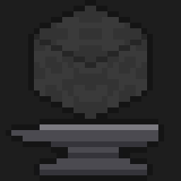
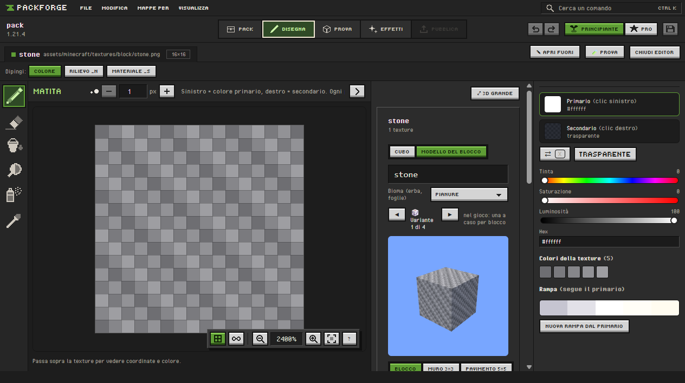
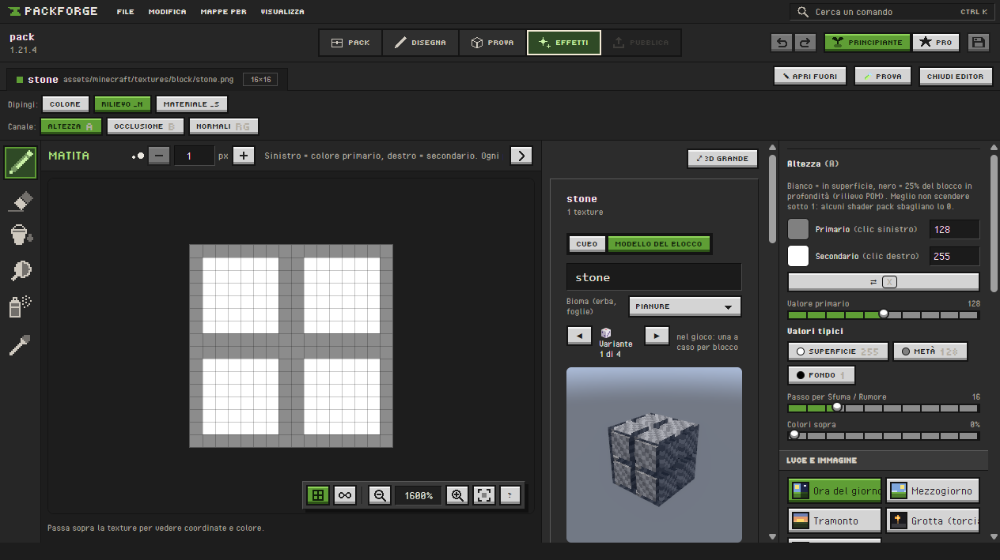

<p align="center">
  
</p>

<h1 align="center">PackForge</h1>

<p align="center">
  <b>L'officina per i resource pack di Minecraft Java.</b><br>
  Disegna la texture, dalle rilievo e riflessi, guardala con la luce di uno shader e mandala nel
  gioco. Tutto in un'unica finestra.
</p>

<p align="center">
  <a href="https://github.com/Andrix03/packforge/releases/latest"></a>
  
  
  
  
</p>

---

Fare un resource pack oggi significa saltare tra un programma di disegno, un generatore di normal
map, un editor di testo per il `pack.mcmeta` e il gioco riavviato cento volte per vedere il
risultato. **PackForge mette tutto questo in un posto solo**: dipingi un pixel e lo vedi subito su
un blocco 3D, con le ombre, il rilievo e i riflessi che avrà con gli shader. Quando ti piace, è
già nella tua cartella `resourcepacks`. Premi F3 + T e sei in gioco.

<p align="center">
  
</p>

## Cosa puoi fare

**Disegna.** Un editor pixel pensato per le texture di Minecraft: matita, secchiello, ombra,
rumore, linee e forme, selezione, simmetria, rampe di colore e bordi continui per le texture che
si ripetono. Con livelli, animazioni a frame e consigli per chi inizia.

**Effetti (LabPBR).** Dipingi le mappe `_n` e `_s` canale per canale (altezza, occlusione,
levigatezza, metalli, emissione), oppure generale dai colori con un clic. Ci sono materiali pronti:
pietra, legno, metallo, vetro, minerale, foglie.

<p align="center">
  
</p>

**Prova.** Metti la texture nel mondo prima di aprire il gioco. Le scene sono un muro, un
pavimento, un campo coltivato, una casa, una grotta con il minerale nella sua roccia e un
sentiero. C'è la luce del giorno, del tramonto, della torcia e del Nether, con POM, pioggia,
riflessi e bloom.

**Lavora in grande.** Puoi applicare un materiale a decine di texture insieme, con il Prima/Dopo in
3D prima di scrivere. Puoi creare texture connesse per Continuity e OptiFine (completo, orizzontale
o verticale), ridimensionare a pixel netti, generare varianti di colore e controllare cosa manca
nel pack.

**Pubblica.** Esporta lo zip con versione, crediti e changelog, anche in una variante senza PBR o a
un'altra risoluzione, con la scheda pronta per Modrinth e CurseForge. Oppure copialo nel gioco e
lascialo aggiornare da solo mentre lavori.

**Principiante o Pro.** La modalità Principiante ha meno strumenti e un tutorial di sei passi. Pro
apre tutto. Il pack è lo stesso e passi dall'una all'altra quando vuoi.

## Scarica

PackForge è in **alpha**: funziona ed è già usabile per un pack vero, ma può avere bug e può
cambiare. Le segnalazioni sono le benvenute nelle [Issues](https://github.com/Andrix03/packforge/issues).

1. Vai nelle [Release](https://github.com/Andrix03/packforge/releases/latest) e scarica
   `PackForge-Setup-<versione>.exe` (installer) oppure `PackForge-<versione>-portable.zip`
   (estrai e avvia `PackForge.exe`).
2. Il programma non è ancora firmato, quindi Windows può mostrare "Windows ha protetto il PC".
   Clicca **Ulteriori informazioni → Esegui comunque**.
3. Apri un pack esistente o creane uno nuovo dalla schermata iniziale.

**Requisiti:** Windows 10 o 11 a 64 bit e una scheda video con WebGL 2. Per le texture vanilla di
riferimento serve Minecraft Java installato con il launcher ufficiale. Per vedere gli effetti in
gioco serve uno shader LabPBR (per esempio con Fabric + Iris).

Linux e macOS non sono ancora disponibili.

## Le regole del gioco

- **Le texture vanilla restano di Mojang.** PackForge le legge dal *tuo* Minecraft solo come
  riferimento, da guardare, ricalcare o usare per prendere i colori. Non vengono mai copiate nel
  tuo pack né nell'export.
- **Il tuo lavoro non si perde.** Ogni scrittura è atomica, i backup si ripristinano con un clic e
  i pack zip si aprono in sola lettura.
- **Il `pack_format` giusto lo sceglie lui** per la versione di Minecraft che indichi, anche con
  gli overlay per più versioni.

## Per sviluppatori

Electron, React, TypeScript e Three.js, con shader GLSL scritti a mano per l'anteprima LabPBR.

```sh
npm ci
npm run dev      # avvia l'app in sviluppo
npm run check    # formato, tipi, lint e test
npm run dist:zip # build portabile per Windows
```

## Crediti

I font dell'interfaccia sono Pixel Operator (CC0) e [Tiny5](https://github.com/Gissio/font_tiny5) (OFL). La specifica dei materiali è
[LabPBR](https://shaderlabs.org/wiki/LabPBR_Material_Standard) di shaderLABS.

---

<sub>PackForge non è un prodotto ufficiale di Minecraft. Non è approvato né associato a Mojang o
Microsoft. "Minecraft" è un marchio di Mojang AB.</sub>
